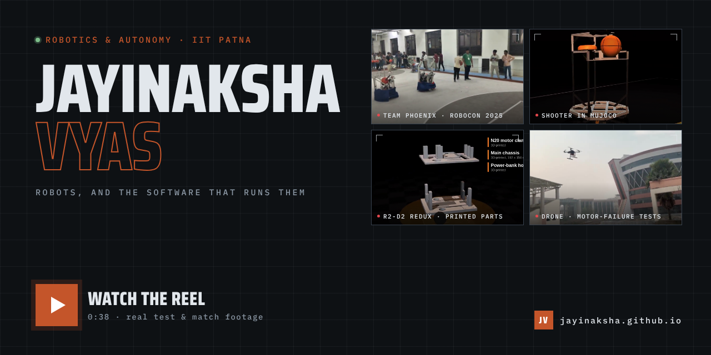
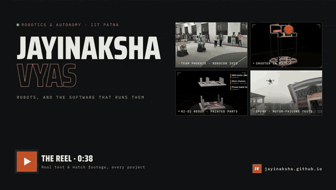

# Jayinaksha Vyas

**Robotics & autonomy engineer · IIT Patna** — B.Tech + M.Tech, Electronics & Communication (2023–2028).
Captain of Team Phoenix, IIT Patna's Robocon team, through the 2025–26 season.

I build robots that keep working when something breaks — a motor, the network, the battery.
Perception and control on the robot, planning in the middle, language models on top.

**[jayinaksha.github.io](https://jayinaksha.github.io/)** — every project, with real footage ·
**[Portfolio](https://jayinaksha.github.io/portfolio/)** ·
[LinkedIn](https://www.linkedin.com/in/jayinaksha-vyas-974051283) ·
[Email](mailto:jayinaksha_2302cm08@iitp.ac.in)

## Work

| Project | What it is | Site | Source |
| --- | --- | --- | --- |
| **Team Phoenix — DD Robocon 2025** | Two basketball robots: an attacker that auto-aims with twin flywheels, and a defender. Forty engineers, one deadline. | [site](https://jayinaksha.github.io/Robocon-25_codes/) | [Robocon-25_codes](https://github.com/Jayinaksha/Robocon-25_codes) |
| **R2-D2 Redux** | Say “go to the table.” A VLM, a semantic map and a 20B planner turn it into a Nav2 goal. | [site](https://jayinaksha.github.io/agentic-bot/) | [agentic-bot](https://github.com/Jayinaksha/agentic-bot) |
| **Single motor failure recovery** | A quadcopter loses a rotor mid-flight, holds attitude on three, and lands. 7th overall, Inter IIT Tech Meet 13.0. | [case study](https://jayinaksha.github.io/portfolio/projects/single-motor-failure/) | [Single_Motor_failure_solution](https://github.com/Jayinaksha/Single_Motor_failure_solution) |
| **ZeroTouch** | Which zone of a room you are in, from the Wi-Fi signal of a $4 ESP32 — and a trackpad made of air. No cameras. | [site](https://jayinaksha.github.io/zerotouch/) | [PRISM](https://github.com/Jayinaksha/PRISM) · [AURA](https://github.com/Jayinaksha/AURA) |
| **Iron** | Agents declared as markdown folders, run as supervised ROS 2 processes, recorded on a log nobody can edit. | [site](https://jayinaksha.github.io/iron-overview/) | private |
| **Slate** | Send it anything; ask for the document later — in your format, every block cited. | [site](https://jayinaksha.github.io/slate/) | private |
| **Newsroom** | A newsroom with no editor — a published ladder decides what counts as verified, and posts its own corrections. | [site](https://jayinaksha.github.io/newsroom/) | private |
| **telenotes** | Telegram in, markdown in your own git repo out. Rust bot, web dashboard, terminal client. | [site](https://jayinaksha.github.io/telenotes/) | [telenotes](https://github.com/Jayinaksha/telenotes) |

Also: [transformable aerial–ground robot](https://github.com/Jayinaksha/transformable_bot) for the ISRO Robotics Challenge ·
[SynthWorld](https://github.com/Jayinaksha/synthworld) synthetic data ·
[CNN accelerator on FPGA](https://github.com/Jayinaksha/cnn_a_parallel_approach).

## On camera

## Tools I reach for

ROS 2 · Nav2 · PX4 · Gazebo · MuJoCo · Rust · C++ · Python · ESP32 · Jetson · Raspberry Pi · RealSense · PyTorch · Verilog

## Open to

Internships and research in robotics and AI systems. Email is the fastest way to reach me:
**jayinaksha_2302cm08@iitp.ac.in**
